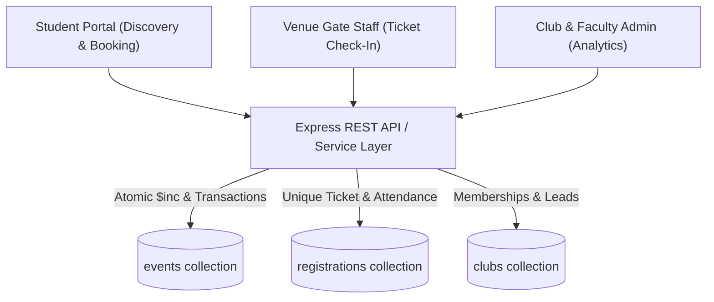
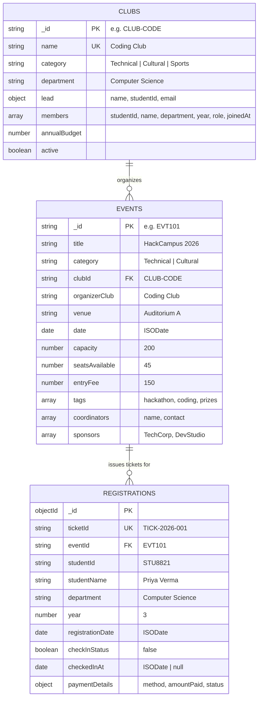

# Architecture & Database Design — Smart Campus Event Engine & Ticket Hub

## 1. System Architecture

The platform separates data persistence (MongoDB `campus_events` database), transactional business logic (Node.js / Express API), and role-oriented UI workflows (Student Discovery, Gate Check-In, and Organizer Analytics).



---

## 2. Entity-Relationship Model

While the core event and registration payloads focus on `events` and `registrations`, Phase 1 specifies **three primary collections**: `clubs`, `events`, and `registrations`. The `clubs` collection normalizes club metadata and memberships while keeping `organizerClub` on `events` for fast read queries and compatibility.



---

## 3. Collection Design & Validation Rules

### 3.1 `clubs` Collection (Completed from Phase 1 Spec)
Handles club memberships across departments and links organizing bodies to events.
- **Key fields**: `_id`, `name` (unique), `category`, `department`, `facultyAdvisor`, `lead`, `members[]`, `createdAt`.
- **Membership pattern**: Embedded `members` array with `{ studentId, name, department, year, role }` allows single-read roster checks for typical college club sizes (20–300 students).

### 3.2 `events` Collection
Stores event schedules, capacity counters, tags, coordinators, and sponsors.
- **Denormalized `organizerClub`**: Kept alongside `clubId` so event search cards render without extra `$lookup` joins, while analytics can still enrich club metadata when needed.
- **Real-time seat counter (`seatsAvailable`)**: Bounded by `0 <= seatsAvailable <= capacity` via schema validation and guarded atomic updates (`seatsAvailable: { $gt: 0 }`).

### 3.3 `registrations` Collection
Stores issued tickets, student affiliation, payment records, and gate check-in state.
- **Unique `ticketId`**: Prevents duplicate ticket codes (`TICK-2026-XXX`).
- **Compound uniqueness on `(eventId, studentId)`**: Prevents a single student from accidentally double-booking the same event.

---

## 4. Indexing Strategy

| Collection | Index Key(s) | Options | Purpose |
| :--- | :--- | :--- | :--- |
| `clubs` | `{ name: 1 }` | `{ unique: true }` | Lookup club by name & enforce uniqueness |
| `clubs` | `{ "members.studentId": 1 }` | Multikey | Fast lookup of all clubs a student belongs to |
| `events` | `{ entryFee: 1, seatsAvailable: 1 }` | Compound | Speeds up Task 2.1 (Free events with >50 seats) |
| `events` | `{ tags: 1 }` | Multikey | Speeds up Task 2.2 (`$in` tag matching) |
| `events` | `{ clubId: 1, date: 1 }` | Compound | Upcoming events per club |
| `registrations` | `{ ticketId: 1 }` | `{ unique: true }` | Instant O(log N) gate check-in lookup (Task 3.2) |
| `registrations` | `{ eventId: 1, studentId: 1 }` | `{ unique: true }` | Prevents duplicate booking per student per event |
| `registrations` | `{ department: 1 }` | Single | Speeds up Task 2.3 & Task 4.2 department analytics |
| `registrations` | `{ eventId: 1, checkInStatus: 1 }` | Compound | Covers Task 4.3 turnout rate aggregation |

---

## 5. Concurrency & Integrity Design

### Atomic Seat Decrement (Task 3.1)
A naive read-then-write causes overselling when two students book the last seat simultaneously. Instead, the filter predicate and `$inc` execute atomically on a single document:
```js
db.events.updateOne(
  { _id: "EVT101", seatsAvailable: { $gt: 0 } },
  { $inc: { seatsAvailable: -1 } }
);
```
If `modifiedCount === 0`, the event is either sold out or does not exist.

### Transactional Ticket Booking (Production API)
In `backend/src/services/registrationService.js`, booking wraps two operations in a single flow (using a MongoDB session/transaction when running on a replica set, with automatic compensation rollback on standalone instances):
1. Atomically decrement `events.seatsAvailable` where `seatsAvailable > 0`.
2. Insert the new document into `registrations` with `checkInStatus: false` and verified `paymentDetails.amountPaid === event.entryFee`.
3. If step 2 fails (e.g., duplicate `(eventId, studentId)`), roll back or increment `seatsAvailable` back by `+1`.

### Idempotent Gate Check-In (Task 3.2)
Checking in at the entrance verifies `{ ticketId, checkInStatus: false }` and sets `checkInStatus: true` plus `checkedInAt: new Date()`. If already checked in, the gate UI warns staff to prevent ticket sharing.
